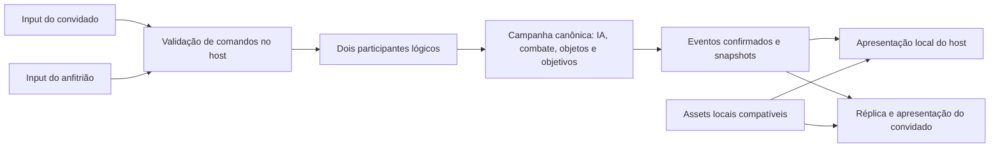

# Co-op por modificações no recomp: uma campanha autoritativa

Proposta de arquitetura para BLACK-XBERecomp-Linux. Este diretório descreve
uma alternativa ao modelo de duas campanhas executadas independentemente e
posteriormente alinhadas por eventos e posições.

**Estado: proposta para investigação e implementação incremental.** A presença
destes documentos não significa que o segundo jogador, a réplica de mundo ou os
novos contratos de rede já estejam implementados.

## 1. Objetivo

O host mantém uma única campanha canônica e dois participantes lógicos. O
convidado controla o segundo participante e recebe uma representação do estado
confirmado pelo host. Os dois PCs desenham suas próprias imagens com os assets
locais; apenas o host decide as consequências compartilhadas de gameplay.

O projeto pode acrescentar esses sistemas como modificações no código do
recomp: hooks, adaptadores para rotinas nativas e componentes C++ próprios.
Não é necessário reconstruir todo o jogo ou substituir seu renderer para
investigar essa abordagem.

## 2. Leitura deste diretório

| Documento | Pergunta respondida |
|---|---|
| [Jogadores e combate](JOGADORES-E-COMBATE.md) | Como criar o participante remoto, integrá-lo à IA e usar sprite ou modelo? |
| [Mundo e missão](MUNDO-E-MISSAO.md) | Como manter spawn, destruição, objetivos e carregamento sob autoridade única? |
| [Rede e validação](REDE-E-VALIDACAO.md) | Como transportar comandos e resultados sem duplicação ou regressão de estado? |
| [Plano de investigação e migração](PLANO-DE-IMPLEMENTACAO.md) | Em que ordem provar viabilidade e substituir a abordagem atual? |

O nome canônico do identificador de rodada nestes documentos é `start_epoch`;
reinício e restauração invalidam a rodada anterior antes de aplicar novos comandos.

Os documentos usam três classificações:

- **Confirmado:** observado no código atual ou registrado nos achados locais,
  com a origem indicada. Um resultado histórico de execução é identificado
  como tal e não equivale a uma execução nova desta proposta.
- **Proposto:** comportamento desejado e interfaces ainda a implementar.
- **Pendente:** uma hipótese que exige leitura adicional, instrumentação ou
  execução do jogo antes de ser tratada como solução viável.

## 3. A mudança principal

| Responsabilidade | Modelo descrito na documentação anterior | Proposta deste diretório |
|---|---|---|
| Campanha | Cada processo executa sua campanha nativa | Host decide a campanha compartilhada |
| Ativação dos inimigos | Cliente ainda depende de seu roteiro local | Host identifica e autoriza a existência dos atores |
| Segundo jogador no host | Não é requisito do espelhamento inicial | É participante lógico explícito |
| Portas e destrutíveis | Caminhos de replicação incompletos | Estado compartilhado autoritativo |
| Objetivos | Repetição de eventos para tentar alinhar roteiros | Estado canônico com eventos identificados e recuperação |
| Cliente | Campanha completa com correções recebidas | Apresentação, input e réplica dos sistemas necessários |

O cliente continua carregando estruturas e executando rotinas locais necessárias
à apresentação. Transformá-lo em réplica exige identificar quais rotinas podem
rodar localmente e quais consequências pertencem ao host. Não se presume que
exista um interruptor nativo para desabilitar a campanha inteira.

## 4. O que significa "o mapa só existe no host"

É preciso distinguir arquivo, estado e imagem:

| Elemento | Host | Convidado |
|---|---|---|
| Arquivos de geometria, texturas e recursos | Carrega localmente | Carrega localmente |
| Estado autoritativo da missão e dos objetos | Mantém e modifica | Recebe e representa |
| Decisões da IA | Executa | Pode precisar de rotinas de apresentação; não confirma consequências próprias |
| Câmera e imagem final | Desenha a visão do anfitrião | Desenha a visão do convidado |

Assim, dois PCs carregarem a geometria não implica haver duas campanhas
autônomas. A rede sincroniza mudanças de estado, não os triângulos estáticos a
cada frame.

Não carregar os assets no convidado exigiria outra arquitetura: o host
renderizaria uma segunda visão, codificaria vídeo e receberia input remoto.
Essa alternativa de streaming fica fora desta proposta, pois demanda outra
cadeia de câmeras, renderização e transporte de mídia e ainda exige um segundo
participante lógico na simulação do host.

## 5. Estrutura proposta

Nomes conceituais para organizar a implementação, não APIs existentes:

- `PlayerRegistry`: identidade, vínculo com entidades locais, equipe e vida.
- `RemotePawnAdapter`: movimento, colisão e integração nativa do convidado.
- `CombatAdapter`: validação de disparo e aplicação de resultados.
- `WorldAuthority`: ciclo de vida de atores e objetos compartilhados.
- `MissionAdapter`: participantes em gatilhos, objetivos e transições.
- `ClientReplica`: materialização e correção do estado recebido.

Usar os hooks e módulos atuais onde o contrato servir. Reutilização depende de
revisão do código atual; não autoriza recuperar implementações arquivadas que
o trabalho anterior rejeitou.

## 6. Sprite de aliado e entidade lógica

O sprite é uma opção de apresentação inicial para o parceiro: um billboard no
mundo, com profundidade e oclusão corretas. Ele não substitui a entidade que
precisa colidir, receber dano, ser percebida pela IA e participar de gatilhos.

Podem existir duas representações ligadas ao mesmo `player_id`:

1. Entidade lógica no host, com volume de colisão, equipe e regras de combate.
2. Representação visual em cada PC, usando sprite inicialmente ou modelo e
   animações depois.

Não é requisito criar outro protagonista completo para a primeira prova. É
requisito demonstrar que os sistemas necessários aceitam uma segunda entidade
com semântica de participante. Esse é o principal risco técnico da proposta.

## 7. Escopo inicial proposto

- Dois jogadores: anfitrião e um convidado.
- Uma área delimitada da missão 1, com os dois próximos e recursos residentes.
- Host encerra a sessão em desconexão; reconexão e migração de host ficam para
  uma fase posterior.
- Fogo amigo desabilitado; vida dos participantes confirmada pelo host.
- Sprite ou marcador temporário para apresentação; personagem 3D é evolução.
- Primeiro validar movimento remoto sem predição. Predição exige um modelo
  de movimento reproduzível e independente de câmera/renderização.
- Objetos que alteram colisão, passagem, dano ou objetivos são compartilhados.
  Efeitos estritamente visuais podem ser locais.

Essas são escolhas propostas para reduzir o experimento. Não descrevem regras
de jogo já aceitas ou implementadas no código atual.

## 8. Evidências e limites

Base de leitura: árvore principal na branch `coop`, HEAD
`b7c0f8d5840c8134b6c72c555999824c41756157`, com alterações locais em andamento.
A revisão também considera os arquivos de trabalho existentes no momento da
análise; o commit sozinho não reproduz esse estado. Data local: 20/10/2026.

- [COOP.md](../COOP.md): arquitetura anterior e contexto histórico; contém
  afirmações posteriormente corrigidas.
- [COOP-FINDINGS.md](../COOP-FINDINGS.md): limitações de ativação e descobertas
  posteriores; "resolvido" para identidade não prova nascimento simultâneo.
- [SDK](../../sdk/README.md): recompilação e substituição de funções por hooks.
- [Layout](../../src/game/layout.h), [mundo](../../src/game/coop_world.cpp),
  [missão](../../src/game/coop_mission.cpp) e
  [sessão](../../src/net/coop_session.cpp): implementação atual.
- `.agents/teamwork/coop/LAYOUT.md` e `BODY.md`: notas locais de investigação,
  quando disponíveis. São ignoradas pelo Git; os documentos novos não devem
  depender delas como único registro permanente de uma decisão.
- [Manuais publicados pela EA](https://github.com/electronicarts/RenderWare3Docs):
  referência conceitual da RenderWare; não demonstram equivalência binária
  com os sistemas personalizados deste jogo.

O setup do REA 6.7.0 foi configurado durante a análise anterior, mas a inspeção
nativa retornou `provider_unavailable`. Não há decompilação nova pelo REA que
prove esta arquitetura. O código recompilado existente e os experimentos
descritos no plano são a base para a próxima investigação.
